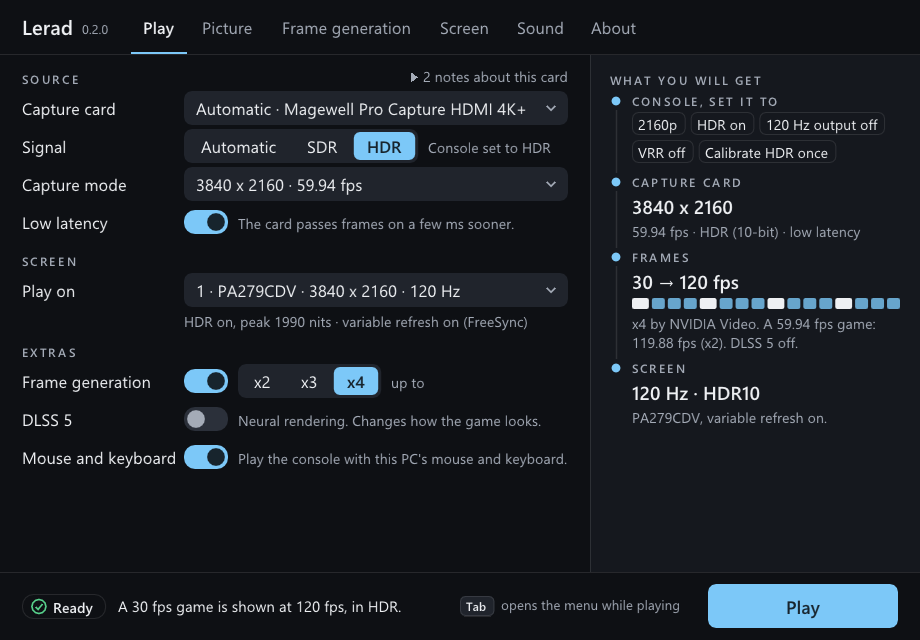
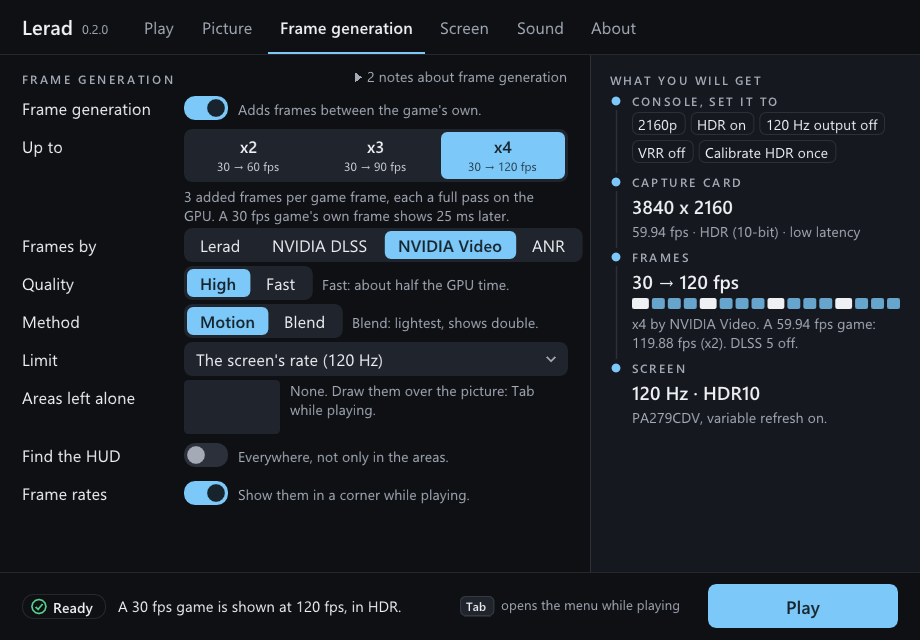
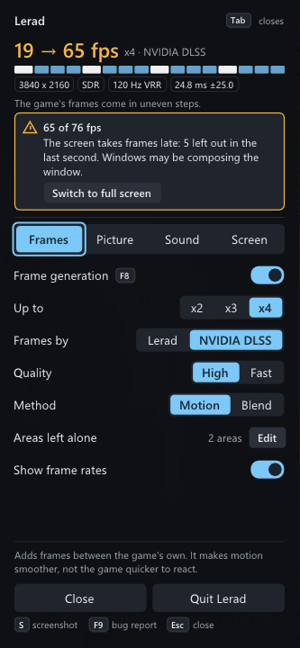

# Lerad

**Your console, with PC graphics.**

[](https://github.com/BennettStaley/Lerad/actions/workflows/build.yml)

[](LICENSE)

Plug a PS5, Xbox Series or Switch 2 into a capture card and play it on your
Windows PC, with frame generation, HDR, DLSS 5 and AI upscaling applied live.
Pick your card and press **Play**.

Lerad is a fork of [Glasir](https://github.com/Abhito/Glasir) by Abhito;
[what Lerad adds](#what-lerad-adds) is below.



| The Frame generation tab | The menu while playing (`Tab`) |
|---|---|
|  |  |

## What it does

- **Frame generation**: a 30 fps game shown at 60, 90 or 120 fps, on any GPU
  (NVIDIA, AMD or Intel). On an RTX 40 or 50 the frames can come from NVIDIA
  DLSS Frame Generation instead.
- **A sharp HUD**: Lerad finds the HUD and shows it as the game drew it in
  the added frames, or you draw the areas to leave alone.
- **HDR that follows the console**: SDR or HDR is told from the picture.
  HDR10 goes to an HDR screen untouched; on an SDR screen it is tone mapped.
- **DLSS 5 neural rendering** on NVIDIA RTX 30, 40 and 50 series GPUs.
- **Upscaling**: FSR 1, the GPU's video super resolution, ArtCNN or Anime4K
  for a capture smaller than the screen.
- **Even pacing**: VRR / G-SYNC / FreeSync, and the card's repeated frames
  are dropped, so 30 fps is an even 30 fps.
- **Advice for your PC**: the window reads your screens, GPU and card, says
  what your settings will come to, and what to set on the console.
- **Low-latency sound**, an in-game menu (`Tab`), screenshots (`s`, HDR
  too), one-key bug reports (`F9`), and a second SDR window to share on a
  stream while you play in HDR.

> [!NOTE]
> Frame generation makes motion smoother. It does not make the game react
> faster: the console still runs at its own rate, and the added frames cost
> a few milliseconds.

## What you need

| | |
|---|---|
| **System** | Windows 11, 64-bit |
| **Capture card** | Any card Windows' video capture can open gets every feature. Others run in a basic mode without frame generation, and Lerad says so. |
| **GPU** | Any DirectX 11 GPU. NVIDIA RTX 30 or newer for DLSS 5, RTX 40 or newer for DLSS Frame Generation. |
| **Screen** | VRR (G-SYNC or FreeSync) is best for pacing, but not needed. |

Lerad's own work was made and tried with a PS5 Pro (SDR and HDR, 4K at 30
and 60), a Magewell Pro Capture HDMI 4K Plus and an Elgato 4K X, an RTX 5090
and a 4K 120 Hz G-SYNC HDR screen. Glasir was tested with a PS5 and a
Switch 2, an AVerMedia Live Gamer Ultra 2.1 and an RTX 5070 Ti. AMD and
Intel GPUs are not yet tested; reports are welcome.

## Getting it

There is no packaged release yet, so build it (two commands):

```
git clone https://github.com/BennettStaley/Lerad
cd Lerad
build.cmd
```

That needs Visual Studio 2022 or 2026 with "Desktop development with C++";
`build.cmd` finds it and its CMake by itself, builds, runs the tests and
puts the app in `out\Lerad`. Then:

1. Start `out\Lerad\Lerad.exe`. The first time it offers to download the
   programs it runs on (mpv, ReShade, and DLSS 5 on an RTX GPU), each from
   where its authors publish it, in the versions Lerad was tested with,
   checked against their SHA-256.
2. Pick your capture card and press **Play**.

The folder is portable: settings (`lerad.ini`), logs and screenshots stay in
it, and deleting it removes Lerad. Lerad does not update itself.

## Using it

The window shows your choices on the left and what they come to on the
right, with what to set on the console. While playing:

| Key | What it does |
|---|---|
| `Tab` | The menu: frame generation, picture, sound, screen |
| `f`, double-click | Full screen on / off |
| `Up` / `Down`, mouse wheel | Volume (`m` mutes) |
| `[` / `]` | Audio delay -/+ 10 ms (lip sync) |
| `F6` / `F8` | DLSS 5 / frame generation on or off |
| `F9` | Save a bug report, with the frames on screen |
| `s` | Screenshot |
| `q`, `Esc` | Quit |

**[The guide](docs/GUIDE.md)** has the rest: every tab, the HUD and the
areas left alone, SDR and HDR, window modes, scaling, screenshots.

## Something wrong?

**[Troubleshooting](docs/TROUBLESHOOTING.md)** covers the usual questions:
frame generation not doubling, VRR, HDR, black bars.

To report a problem, press **`F9`** while it happens, then
[open an issue](https://github.com/BennettStaley/Lerad/issues) and attach
the zip from `Bug reports\`. It holds the logs, your settings, GPUs and
screens, and small pictures of the frames on screen; your Windows user name
is left out.

## Building

```
build.cmd            build, test, put the app in out\Lerad
build.cmd check      build and test only (out\ is not touched)
build.cmd package    ... and the release zip, out\Lerad-x.y.z.zip
```

Every push is built and tested by [GitHub Actions](.github/workflows/build.yml).
[CONTRIBUTING.md](CONTRIBUTING.md) has the layout, the licence rules and how
to test without a capture card.

## What Lerad adds

Lerad started from Glasir 0.2.0 and has gone its own way since:

- **More frame generators**: NVIDIA DLSS Frame Generation beside Lerad's own,
  and two experimental ones as optional downloads (NVIDIA Video Frame
  Generation, Apex ANR).
- **A HUD found by itself**, and **areas left alone** that you draw over a
  map or subtitles.
- **A new window and menu** with a live readout, and advice from your
  screens, GPU and card (with a one-button G-SYNC fix for NVIDIA's driver).
- **Pacing by the screen the picture is on**, a step down to a multiplier
  the screen can hold, and repeated frames told apart by the card's real
  rate.
- **Magewell Pro Capture cards**: low-latency mode and their sound.
- **A stream window**: a live SDR copy of the picture for Discord or OBS.
- **Mouse and keyboard**: Lerad can start an input program of yours with
  the picture (none is included).
- **No self-update.**

## Licence and credits

Lerad is under the [MIT licence](LICENSE); the frame generation code in
`src/framegen` is under the [Mozilla Public License 2.0](LICENSES/MPL-2.0.txt).
Third-party components: [THIRD-PARTY-NOTICES.md](THIRD-PARTY-NOTICES.md).

Most of what is here is the work of [Glasir](https://github.com/Abhito/Glasir)
by Abhito, itself based on
[MPV-SW-Capture](https://github.com/TyRaS-SW/MPV-SW-Capture) by TyRaS-SW,
with the WASAPI audio plugin by [z-er](https://github.com/z-er/MPV-SW-Capture).
DLSS 5 support uses [DLSS5-Feeder](https://github.com/jlrouzies-fr/DLSS5-Feeder)
by jlrouzies-fr and RenoDX-DLSS5. Built on [mpv](https://mpv.io) and
[ReShade](https://reshade.me) by crosire.

Lerad is not affiliated with or endorsed by NVIDIA, AMD, Intel, Sony,
Nintendo, Microsoft or the authors of the projects above. DLSS, G-SYNC and
RTX are trademarks of NVIDIA Corporation; other names belong to their
owners.
