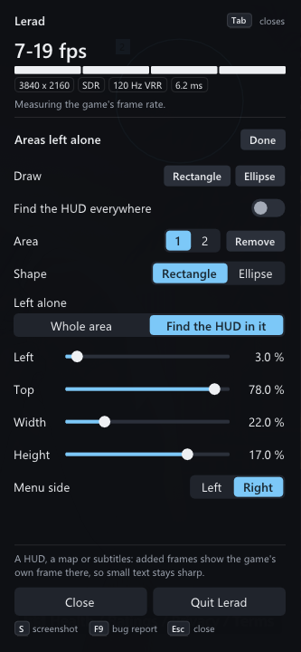

# Using Lerad

The [README](../README.md) has the short version. This is the rest.

- [Lerad's window](#lerads-window)
- [The menu while playing](#the-menu-while-playing)
- [A HUD in the added frames](#a-hud-in-the-added-frames)
- [SDR and HDR](#sdr-and-hdr)
- [Keys](#keys)
- [Window modes](#window-modes)
- [Scaling](#scaling)
- [Screenshots](#screenshots)
- [Tuning DLSS 5](#tuning-dlss-5)
- [What Lerad downloads](#what-lerad-downloads)

## Lerad's window

`Lerad.exe` opens its window first: your choices on the left, what they
come to on the right, **Play** at the bottom.

On the **Play** tab, pick the capture card, the signal (Automatic, SDR or
HDR), the capture mode and the screen to play on, switch frame generation
and DLSS 5 on or off, then press **Play**. The right side follows as you
choose:

- **Console, set it to** lists what to set on the console: the output
  resolution, HDR on or off, 120 Hz output and VRR. A console only sees the
  capture card, not what Lerad does, so it cannot pick these by itself. VRR
  stays off on the console: the card needs a steady rate, and variable
  refresh does its work on the PC's screen.
- **Capture card**, **Frames** and **Screen** say what your choices come to
  on this PC: the capture mode, the frame rate shown (30 to 120 fps, with a
  strip that shows the game's own frames among the added ones), and the
  screen with its HDR and variable refresh state.
- **Worth a look** shows what will not work as set, and settings that would
  suit this PC better. **Use**, **Fix** or **Download** takes the
  suggestion; nothing is shown when your settings already match.

The other tabs hold what is needed less often:

| Tab | What is on it |
|---|---|
| **Picture** | An HDR signal: send it as HDR or as SDR, fit its highlights to the screen, the console's peak, the menu's brightness. An SDR signal: its range. How a smaller capture is scaled up. |
| **Frame generation** | Up to x2, x3 or x4 (with what each comes to on your screen), whose frames (Lerad's own, NVIDIA DLSS Frame Generation, or one of the experimental ones once downloaded), quality, method, a limit on the frames shown, the areas left alone, **Find the HUD**, and the frame rate readout. |
| **Screen** | The screen to play on (each with its size, refresh rate, HDR and variable refresh), the GPU that draws on a PC with several, the window (full screen, borderless or a window), and the stream window. |
| **Sound** | The card's sound and its input, volume, boost, audio delay, and lowest latency or steadier timing. |
| **About** | What is downloaded and the buttons to download more, **Save a bug report**, the settings file and the logs folder, and whether this window shows at start. |

- A choice that cannot work here is greyed out and says why (HDR on a card
  without a 10-bit mode, x3 on a fixed 120 Hz screen, DLSS 5 on another
  GPU).
- Switch "This window" off on the About tab to play at once. Hold **Shift**
  while starting Lerad to see the window again, or start it with
  `Lerad.exe --play` to skip it.
- Everything is kept in `lerad.ini`, and every key is explained in the
  file. What you change while playing (volume, boost, audio delay, the menu)
  is saved there too.
- `Lerad.exe --system` prints what Lerad found on your PC (GPUs, each
  screen, the capture card), what your settings will do there and what to
  set on the console: the same as the window shows, as text.

## The menu while playing

`Tab` opens the menu over the picture; `Tab` or `Esc` closes it. Its top
shows what is happening now: the game's frame rate and the rate shown, the
picture's size, SDR or HDR, the screen's rate. When something holds the
picture back (the screen takes frames late, the GPU cannot keep up), a
notice says so, with a button for the way out.

| Tab | What is on it |
|---|---|
| **Frames** | Frame generation, up to x2 to x4, whose frames, quality, method, the areas left alone, the frame rate readout |
| **Picture** | DLSS 5, scaling, the signal (Automatic, SDR, HDR) and what is done with HDR |
| **Sound** | Volume, mute, boost, audio delay |
| **Screen** | Full screen, borderless or a window, the screen the picture is on, the stream window |

## A HUD in the added frames

A frame made between two of the game's own follows what moves. A HUD does
not move with the scenery behind it, so text and icons can smear or show
double. There are two ways to stop that, and they work together:

- **Find the HUD** (Frame generation tab, or the menu's areas page): Lerad
  watches for pixels that hold still while the scenery around them moves,
  and shows those as the game drew them. It finds most of a HUD within a few
  frames, all of it within about a second of play. Numbers that change every
  moment (a counter, a compass) are not held.
- **Areas left alone**: in the menu, **Edit** beside "Areas left alone",
  then **Rectangle** or **Ellipse**, and drag over the picture. Drag an
  area to move it, an edge or a corner to size it; `Delete` or its small
  box removes it. For each area, pick **Whole area** (the added frames show
  the game's own frame there: right for a map or subtitles) or **Find the
  HUD in it** (only the HUD's own pixels are kept, the scenery between them
  still moves smoothly).

## SDR and HDR

**Signal** in Lerad's window, and in the menu, has three choices:

- **Automatic** (the default): Lerad captures in the card's 10-bit mode and
  tells from the picture whether the console sends SDR or HDR. When that
  changes, Lerad follows while you play, without starting the picture
  again. A card without a 10-bit mode plays SDR.
- **SDR** or **HDR**: you say it. SDR also offers the card's 8-bit modes,
  which are often larger or faster. Use these if Automatic gets a game
  wrong: a console set to a peak of 5000 nits or more can read as SDR in
  very bright scenes, and a grey, dim SDR scene without any white can read
  as HDR.

HDR needs HDR on in Windows (Settings, Display) too.

## Keys

| Key | What it does |
|---|---|
| `Tab` | [The menu](#the-menu-while-playing) (`Esc` or `Tab` closes it) |
| `f`, double-click | Full screen on / off |
| `Up` / `Down`, mouse wheel | Volume |
| `m` | Mute |
| `Ctrl+Up` / `Ctrl+Down` | Audio boost (up to 400 %) |
| `[` / `]` | Audio delay -/+ 10 ms (lip sync) |
| `Ctrl+r` | Restart the sound (after changing the output device) |
| `F6` | DLSS 5 on / off (this session) |
| `F8` | Frame generation on / off (this session; needs ReShade) |
| `F9` | Save a bug report, with the frames on screen |
| `s` | Screenshot |
| `Home` | ReShade's overlay |
| `q`, `Esc` | Quit (`Esc` closes the menu first when it is open) |

While the menu is open, the keyboard and mouse go to it.

## Window modes

The menu's **Show as** switches at once and keeps the choice:

- **Borderless**: a window without a frame that fills the screen.
- **Full screen**: mpv's own, what `f` or a double-click switches. Leaving
  it goes back to the borderless window.
- **Window**: a normal window.

Neither full screen is exclusive, but Windows flips both straight to the
display (Independent Flip), which is as fast.

On a screen of another shape than the picture (a 16:9 console on an
ultrawide) the picture is as large as fits, with black bars beside it.
**Skip black bars** on the Screen tab makes the window the picture's size,
so DLSS 5 and frame generation skip the bars. It is off by default: on some
PCs Windows then composes the window, and frame generation falls short (see
[Troubleshooting](TROUBLESHOOTING.md)).

The **stream window** (Screen tab) is a second, SDR window with a live copy
of the picture, for Discord or OBS while the main picture stays HDR. It
opens on another screen than the picture and shows the game's own frames.

## Scaling

A capture smaller than its place on the screen (1080p on a 1440p screen) is
scaled up before DLSS 5. Pick how under "Scaling", in Lerad's window or
the menu (it switches at once):

| Scaling | GPU | What it's like |
|---|---|---|
| mpv's own (Lanczos) | any | Plain, the lightest |
| **AMD FSR 1** | any | Sharper edges |
| **Video super resolution** (VSR) | NVIDIA RTX, Intel | The GPU's video engine; FSR 1 where it cannot run |
| **ArtCNN** | any | A small neural network that rebuilds fine detail; the sharpest, for some more GPU time |
| **Anime4K** | any | Made for drawn and cel-shaded styles; the most GPU time |

A capture mode of the screen's height needs no scaling at all.

## Screenshots

`s` saves the picture as it is on screen to `Screenshots\`: after scaling
and DLSS 5, without the menu, the messages or the black bars.

- **SDR**: a PNG.
- **HDR**: a `.jxr` (Windows' own HDR picture format; Photos shows it in
  HDR) and a PNG made SDR for sharing.

Without ReShade, `s` saves the card's picture as it comes in.

## Tuning DLSS 5

DLSS 5 starts with its authors' default settings. To tune it, open
ReShade's overlay (`Home`): RenoDX-DLSS5 is on the Add-ons tab, DLSS5_Feed
on the Home tab (untick "Performance Mode" to edit it). Your changes stay
in `engine\ReShade.ini` and `engine\ReShadePreset.ini`; Lerad only switches
DLSS 5 on or off there.

## What Lerad downloads

- [mpv](https://github.com/zhongfly/mpv-winbuild)
- [ReShade](https://reshade.me) with add-on support
- DLSS 5, on an NVIDIA RTX 30, 40 or 50 series GPU: DLSS5-Feeder,
  RenoDX-DLSS5 and NVIDIA's neural rendering from
  [RHI's mirror](https://github.com/RankFTW/rhi-repo) and
  [NVIDIA DLSS](https://github.com/NVIDIA/DLSS)
- Only when you ask for them, on the About tab: NVIDIA DLSS Frame
  Generation, NVIDIA Video Frame Generation (behind NVIDIA's licence
  prompt) and Apex ANR

Lerad downloads the versions it was tested with, so a new release of one of
them does not reach you before a Lerad tested with it does. Every download
is checked against the SHA-256 recorded for that version. If a tested
version is no longer offered (mpv's builds are kept about a month), the
newest takes its place. `engine\components.ini` says what is installed;
**Download tested versions** on the About tab (or `Lerad.exe --setup`)
installs the tested ones again.

To move to a newer Lerad, unpack or build it over the folder you have: your
settings, screenshots, logs and downloaded programs stay as they are.
